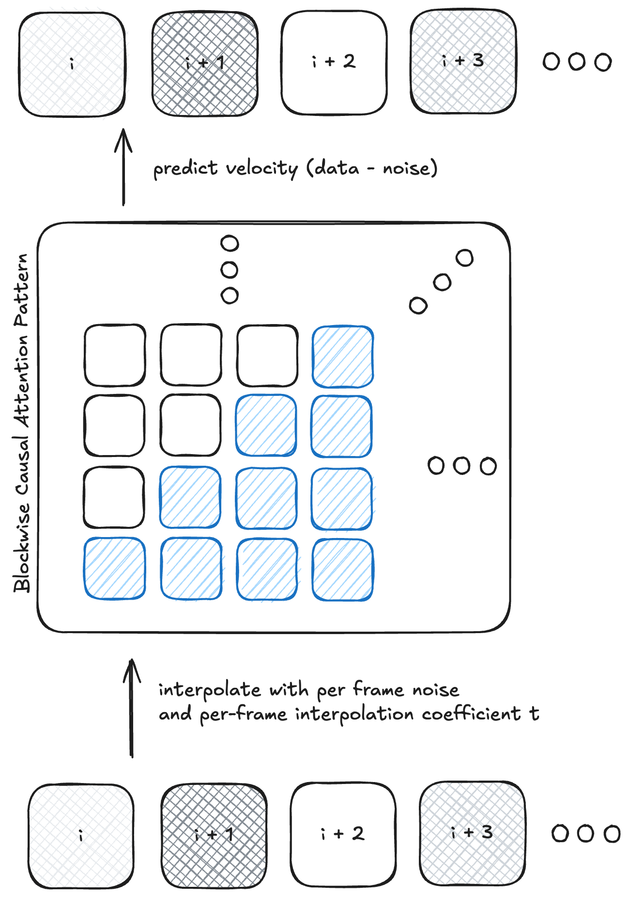

# Mariner: Training Random-order Autoregressive Video World Models

< > 
TOD0 (NECESSARY EXPERIMENTS):
- [ ] Philippe tokenizers
- [ ] x-prediction experiments
< > 

We detail the efforts we undertook in building random-order video world models. Random-order pre-training allows for temporal in-painting (goal conditioned generation) and out-painting (extrapolating forward/backward in time) along with next-frame generation. This flexible framework unifies complicated pre-training procedures like image-to-video, text-to-video, and video in-painting into one run. We further find that mixing random-order training with standard auto-regressive training results in video diffusion models that have significantly improved auto-regressive generation. We explore this somewhat paradoxical result in more detail in this post.

## Primer on Diffusion World Models

There are many ways one could model the physical world. With diffusion world models, we aim to do it directly from pixels, with no explicit underlying structure. The downside is likely that this is more data inefficient. The upside is that it's (hopefully) more general and we do not have to hand-encode 3D inductive biases.

 
<em>Figure 1: Caption placeholder</em>

## Evaluation

Every good research project starts with a robust evaluation setup. In general, evaluating video generation models has unique challenges. Since we're generating in a complex high-dimensional space, any automated metric needs to itself model some aspect of the real world and involves some degree of subjectivity (unlike text, where for some tasks you can use string matching with a ground truth response). We care about the following properties for our world model:

1. Accuracy of pose-conditioned frame prediction. This is often referred to as novel-view synthesis. However, this setting is different in our case, since we also have a time varying component and potential dynamic objects. 
2. Fidelity of the generated video. This is an overall subjective judgment for how well our videos match the distribution of videos we're trying to generate.
3. Amount of auto-regressive drift also known as "exposure bias". This effect occurs because the training distribution, clean frames, differs from the inference distribution, frames generated using a diffusion model. 

### A Primer on Scaling Laws

While pointwise evaluations are useful, ultimately we care about how various changes we make improve the _scaling properties_ with respect to these metrics. This provides us a much clearer picture as to whether or not the changes we make are actually useful. Is some new complex algorithm actually worth it, or do the effects get washed out by simply increasing compute? This is especially important because we simply do not have the resources to train an effective 70B model, so for this work to be impactful, we need useful scaling trends.  

We follow a simplified version of the scaling frameworks from Kaplan et al. and Hoffman et al. 

